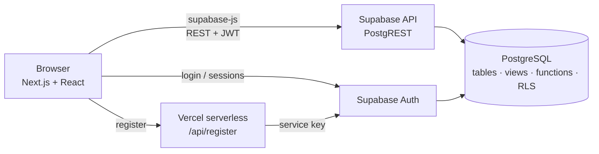

# PulseGym: Gym Booking System

A web application for booking group fitness classes (Yoga, Pilates, HIIT, Spinning, Zumba) across several gym branches.
Members register with a phone number, browse the schedule and book a place. The system enforces class capacity and membership rules, and records attendance through an NFC check-in.

**Live site:** https://gymbooking-bis.vercel.app
**Course:** Basics of Information Systems, KBTU, team project (Business Experts)

---

## Features

**Members**
- Register and log in with phone number and password
- Browse the schedule, filter by branch, class type and day, and see places left in real time
- Book a class. A booking is rejected if the class is full, already booked, already started, or the membership is suspended or expires before the class.
- When a booking is rejected, get up to 3 other times of the same class to book instead
- My Profile: name, membership status, expiry date, upcoming bookings and history
- Cancel for free until 3 hours before the class. Later cancellations need confirmation and forfeit the booking fee.
- Missing a class without cancelling marks the booking as No-show and forfeits the fee
- My progress: classes attended, missed and attendance rate
- Search trainers, branches and own bookings
- Interface in Kazakh, English and Russian. The choice is saved on the account.

**Trainers**
- See their own upcoming classes with attendee names. They can't see other trainers' classes or members' contact details.

**Admins**
- Admin panel: create, edit and delete sessions, class types, trainers, branches and rooms
- Manage members: role (Member / Trainer / Admin), membership status and expiry
- Search all bookings
- NFC check-in: record a member's arrival and mark the booking as Attended
- Manual check-in when the NFC reader fails (after the class has started)
- Attendance report: booked, came and missed per finished class, with attendance rate

---

## Tech stack

| Layer | Technology | Purpose |
|---|---|---|
| Frontend framework | **Next.js 16** (App Router) | Pages, routing, build |
| UI library | **React 19** | Components and state |
| Language | **TypeScript** | Type safety across the app |
| Styling | Plain CSS | Layout, light/dark theme, mobile layout |
| Localization | Custom dictionary (`src/lib/i18n.ts`) | Kazakh / English / Russian |
| Database | **PostgreSQL** (hosted by Supabase) | All data and business rules |
| API | **PostgREST** (built into Supabase) | Generates a REST API from tables, views and functions |
| Authentication | **Supabase Auth** | Accounts, sessions, bcrypt password hashing |
| Database client | `@supabase/supabase-js` | Frontend → Supabase calls |
| Server code | Next.js API route (`/api/register`) | Creates accounts using the secret key, which stays on the server |
| Hosting | **Vercel** (app), **Supabase Cloud** (database + auth) | Deployment |

### Architecture



There is no separate backend server. The frontend talks to Supabase directly, and the backend logic lives in PostgreSQL:
- **Tables and constraints** keep the data valid (unique bookings, capacity limits, no overlapping sessions).
- **SQL functions** carry out the business actions (`book_session`, `cancel_booking`, `check_in_booking`). Each runs as one transaction.
- **Row Level Security (RLS)** and role checks decide who can read or change what. The rules apply even if someone calls the API directly, bypassing the website.

### How a booking works

1. The member clicks **Book**.
2. The browser calls the database function `book_session(session_id)` with the member's login token.
3. The function locks the session row, then checks login, session time, membership status and expiry, duplicate booking, and capacity.
4. It inserts the booking, or returns a rejection code such as `class_full`.
5. The frontend translates the code into the selected language. On `class_full` or `already_booked` it also offers up to 3 alternative sessions.

The row lock means two members can't take the last place at the same moment.

---

## Database

9 tables in PostgreSQL:

| Table | Stores | Key rules |
|---|---|---|
| `branches` | Gym locations | Unique front-desk phone |
| `rooms` | Rooms in a branch | Max capacity > 0; room name unique per branch |
| `trainers` | Trainer profiles | Contacts visible to admins only |
| `classes` | Class types (Yoga, Pilates…) | Unique name, duration in minutes |
| `class_sessions` | Scheduled classes | End after start; capacity ≤ room size; no overlapping sessions in the same room or for the same trainer |
| `members` | Accounts and memberships | Unique phone; role Member / Trainer / Admin; preferred language |
| `bookings` | Member ↔ session (bridge table) | `UNIQUE(member_id, session_id)`; status Confirmed / Cancelled / Attended / No-show |
| `readers` | NFC readers | Linked to a branch |
| `check_in_logs` | Arrivals | One check-in per booking |

Relationships: Branch 1:M Rooms, Branch 1:M Sessions, Class 1:M Sessions, Trainer 1:M Sessions, Member M:N Session (through Bookings), Booking 1:0..1 Check-in.

**Views** give each role the data it may see:

| View | Shows |
|---|---|
| `v_sessions` | Public schedule with places taken (no personal data) |
| `v_me` | The logged-in member's own record and membership status |
| `v_bookings` | Own bookings for members, all bookings for admins |
| `v_trainer_roster` | A trainer's own classes with attendee names |

**Membership status:** only `Active` / `Suspended` are stored. `Expired` is calculated from `membership_expiry`, so it can never go out of date.

---

## Security

- Passwords are stored by Supabase Auth as **bcrypt** hashes, never in plain text.
- Every table has **Row Level Security** turned on. Members can change data only through the booking functions. Catalog tables (sessions, trainers, branches…) can be changed only by admins.
- Admin and trainer pages redirect other roles to the main page, and the database blocks their data access as well.
- The Supabase **secret key** is used only in the server-side `/api/register` route and is never sent to the browser.
- Admins can't remove their own Admin role, so the system can't be left without an admin by accident.

---

## Project structure

```
src/
  app/
    page.tsx              Schedule and booking
    login/                Log in and registration
    profile/              My Profile, cancellations
    search/               Search
    trainer/              Trainer's classes
    admin/                Admin panel
    api/register/         Server-side registration
  components/             Header, dialogs, admin table editor, auth and language state
  lib/
    supabaseApi.ts        All calls to Supabase
    demoApi.ts            Same logic in the browser (demo mode, no database)
    i18n.ts               Kazakh / English / Russian texts
    types.ts, validate.ts, format.ts
supabase/
  schema.sql              Tables, constraints, views, functions, security rules
  seed.sql                Sample branches, rooms, trainers, classes and 7 days of sessions
  migration_trainer_signup.sql  Trainer applications, certificate storage, approve / reject
```

---

## Running locally

Requirements: Node.js 20 or newer.

```bash
npm install
npm run dev        # http://localhost:3000
```

Without environment variables, the app runs in **demo mode**: data is kept in the browser and two test accounts are available:
- Admin `+7 700 000 0001` / `admin123`
- Trainer `+7 700 000 0002` / `trainer123`

### Connecting Supabase

1. Create a Supabase project. In the **SQL Editor**, run `supabase/schema.sql`, then `supabase/seed.sql`,
   then `supabase/migration_trainer_signup.sql`.
2. Create `.env.local` (see `.env.example`):

   ```
   NEXT_PUBLIC_SUPABASE_URL=https://<project>.supabase.co
   NEXT_PUBLIC_SUPABASE_ANON_KEY=<publishable / anon key>
   SUPABASE_SERVICE_ROLE_KEY=<secret / service_role key>
   ```
3. Register in the app, then make yourself admin in the SQL Editor:

   ```sql
   update public.members set role = 'Admin' where phone_number = '+77011234567';
   ```
   After that, assign roles in **Admin panel → Members**.

### Trainer sign-up

On the registration page a person chooses **Member** or **Trainer**. A trainer also gives an email,
specialization, years of experience, an optional bio and 1–5 certificates (PDF/JPG/PNG, up to 5 MB each).

- The account is created as a normal **Member**; the certificates go to the private Storage bucket
  `trainer-certificates` and an application with status *Pending* is saved.
- The applicant can use the site as a client meanwhile and sees the status in **My Profile**.
- An admin opens **Admin panel → Trainer applications**, opens the certificates (5-minute links),
  and approves or rejects with a reason. Approve creates the trainer profile and switches the role to
  **Trainer**; after a rejection the person can apply again from the profile.
- A user can never make themselves a Trainer: the role only changes inside the admin-only
  `review_trainer_application` function.

### Deploying

The project is deployed on **Vercel**, connected to this GitHub repository. Every push to `main` deploys automatically. The three environment variables above are set in Vercel → Settings → Environment Variables.

---

## Limitations (MVP)

- No online payments. A late cancellation is recorded as `fee_forfeited` for future billing.
- No SMS verification or password reset.
- NFC check-in is simulated from the admin panel; no hardware integration yet.
- Class descriptions and branch names are shown as entered and aren't translated.
- New members receive a 30-day membership by default.

---

## Team

Business Experts, KBTU:
Dzhadrinova Diana · Pak Milana · Mamedova Mariya · Seitbek Arnur · Safiyulla Aizere
